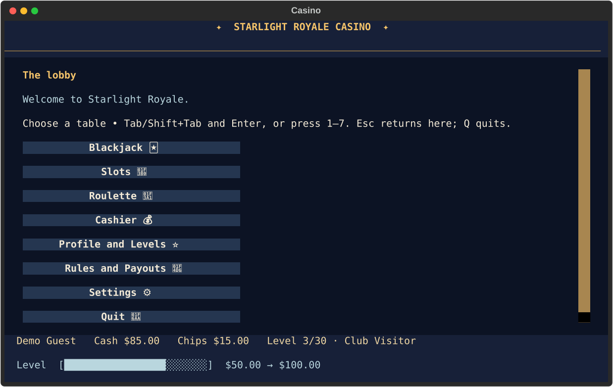

# Starlight Royale Casino

A terminal casino with three games, a cashier, and a cash-based membership ladder. It uses **virtual cash and virtual chips only**. There are no payments, purchases, prizes, bank connections, or redemption for money.



The interface uses warm gold on deep blue, with a few starlight and frontier details. Menus and rules keep text labels beside emoji. Terminal emoji width varies by font; if a symbol looks crowded, its text label and the rules remain readable. A window smaller than 70 columns by 22 rows shows a resize message.

## Install once, then launch

Python 3.10 or newer and Git are required. [pipx](https://pipx.pypa.io/stable/installation/) installs this command in its own environment and puts `starlight` on your normal PATH.

**macOS / Linux (Terminal):**

```sh
git clone https://github.com/SavelMoshi/starlight-royale.git
cd starlight-royale
python3 -m pip install --user pipx
python3 -m pipx ensurepath
# Open a new Terminal window after ensurepath.
python3 -m pipx install .
starlight
```

**Windows CMD:**

```bat
git clone https://github.com/SavelMoshi/starlight-royale.git
cd starlight-royale
py -m pip install --user pipx
py -m pipx ensurepath
REM Open a new CMD window after ensurepath, then return to this folder.
py -m pipx install .
starlight
```

If `pipx` is already installed, start with `pipx install .` (or `py -m pipx install .` on Windows). Some managed Python installs require installing pipx through the OS package manager; see the linked pipx instructions. The fallback entry point is `python -m starlight_royale` in any Python environment where this project is installed. A local virtual environment also works:

```sh
python3 -m venv .venv
source .venv/bin/activate
python -m pip install .
starlight
```

For Windows CMD, replace the first two virtual-environment lines with `py -m venv .venv` and `.venv\Scripts\activate.bat`. PowerShell can use the pipx commands above with `py -m`, too. A virtual environment must be activated in each new shell; pipx is the route to an everyday `starlight` command without activation. Installation and the console script were verified in a fresh virtual environment on macOS. Windows CMD was configured but could not be run locally.

## Controls and first visit

Use **Tab** and **Shift+Tab** to move between controls, **Enter** to activate, **1–7** for lobby destinations, **Esc** for the lobby, and **Q** to quit. The Blackjack screen also accepts **H** to hit, **S** to stand, and **D** to double; Slots and Roulette accept **S** to spin when an input is not focused. Available controls appear on screen.

Create a display name and choose USD (`$`), EUR (`€`), or GBP (`£`) when the app first opens. This changes the display symbol only; it performs no exchange conversion. You start with **25.00 virtual cash and zero chips**. Visit the **Cashier** and deposit cash into chips before playing.

The cashier transfers at **1 cash = 1 chip**. Deposit moves cash to chips; withdraw moves chips to cash. **Free top-up** adds cash in an amount you choose. Transfers and top-ups do not affect gameplay profit or loss. Amounts must be positive, affordable where applicable, and have no more than two decimal places. Balances use decimal arithmetic and always display two places. Wagers may use any available chip amount; there is no fixed low maximum bet.

## Games and payouts

Payout multipliers below are **total chips returned, including the original wager**. A losing bet returns zero. The on-screen rules show the same tables before betting.

### Blackjack 🃏

A shuffled 52-card deck is used for each hand. Number cards are face value, face cards are 10, and aces are 1 or 11. The dealer stands on **all 17s, including soft 17**. Player and dealer naturals are checked before any action.

| Result | Return | Net on a 10.00 wager |
| --- | ---: | ---: |
| Natural blackjack (3:2 profit) | 2.5× | +15.00 |
| Ordinary win or dealer bust | 2× | +10.00 |
| Push | 1× | 0.00 |
| Loss or player bust | 0× | −10.00 |

Hit takes another card. Stand ends your turn and lets the dealer play. Double down is available only on your first two cards if you can match the wager; it draws exactly one card, then stands. No split, insurance, or surrender. A half-cent from a 3:2 payout is rounded **half up** to the nearest cent.

### Slots 🎰

Three independent reels each use the same weighted symbol distribution. These are weights out of 100 per reel, not balance-dependent odds.

| Symbol | Name | Weight | Three matching return |
| --- | --- | ---: | ---: |
| 🍒 | Cherry | 30 | 3× |
| 🍋 | Lemon | 25 | 4× |
| 🔔 | Bell | 20 | 6× |
| ⭐ | Star | 15 | 10× |
| 💎 | Diamond | 10 | 20× |

Exactly two cherries with a different third symbol return **2×**. Every other result returns **0×**. The brief reel animation is separate from the already selected outcome; it cannot alter the payout.

### Roulette 🎡

The European wheel has **0–36**, with one green zero. Place one wager per spin.

| Bet | Win condition | Return |
| --- | --- | ---: |
| Red or black | Result has that color | 2× (1:1 profit) |
| Odd or even | Nonzero result has that parity | 2× (1:1 profit) |
| First, second, or third dozen | 1–12, 13–24, or 25–36 | 3× (2:1 profit) |
| Single number | Exact result, including 0 | 36× (35:1 profit) |

Zero loses on red/black, odd/even, and dozen bets.

## Cash levels

There are exactly 30 membership levels. **Current cash balance** determines the level. It is not a permanent achievement or a measure of skill. Depositing cash into chips can lower it; withdrawing chips or taking a free top-up can raise it. The bottom bar shows progress from the current threshold to the next. Level 30 shows a full bar.

| Level | Rank | Cash threshold | Level | Rank | Cash threshold |
| ---: | --- | ---: | ---: | --- | ---: |
| 1 | Guest | 0 | 16 | Gold Ace | 17,500 |
| 2 | New Arrival | 25 | 17 | Gold Circle | 25,000 |
| 3 | Club Visitor | 50 | 18 | Gold Reserve | 40,000 |
| 4 | Card Holder | 100 | 19 | Platinum Guest | 60,000 |
| 5 | Table Regular | 200 | 20 | Platinum Player | 90,000 |
| 6 | House Guest | 350 | 21 | Platinum Ace | 140,000 |
| 7 | Bronze Member | 500 | 22 | Platinum Circle | 220,000 |
| 8 | Bronze Seat | 750 | 23 | High Stakes Member | 350,000 |
| 9 | Bronze Ace | 1,000 | 24 | High Stakes Ace | 550,000 |
| 10 | Silver Ace | 1,500 | 25 | Frontier High Roller | 850,000 |
| 11 | Silver Member | 2,500 | 26 | Royale Member | 1,300,000 |
| 12 | Silver Lounge | 4,000 | 27 | Royale Ace | 2,000,000 |
| 13 | Silver Star | 6,000 | 28 | Royale High Roller | 3,500,000 |
| 14 | Gold Member | 8,500 | 29 | Starlight Elite | 6,000,000 |
| 15 | Gold Spur | 12,000 | 30 | Royale Legend | 10,000,000 |

## Local save and privacy

The versioned JSON profile stores your display name, currency symbol choice, balances, game counts and wins, gameplay net, and the dealer line setting. It is written atomically after balance changes. No player save belongs in the repository.

Default save location:

- macOS/Linux: `~/.local/share/starlight-royale/profile.json` (or under `$XDG_DATA_HOME`)
- Windows: `%APPDATA%\starlight-royale\profile.json`

For testing or a separate profile, set `STARLIGHT_SAVE` to a file path before launch. If loading fails, the app explains the problem and leaves the file intact. The recovery button archives it beside the save before creating a new profile. You can also quit and inspect the JSON yourself. An interrupted Blackjack hand keeps its already debited wager; it counts as a played hand and a loss in gameplay net, while no win is recorded.

## Development

```sh
python -m pip install ".[dev]"
python -m pytest -q
ruff check .
ruff format --check .
```

Game rules are in `src/starlight_royale/`, separate from `app.py`. Tests inject fixed decks, reel draws, and wheel results. Production draws use `secrets.SystemRandom`. The GitHub Actions workflow runs tests and Ruff on macOS, Linux, and Windows for Python 3.12 and 3.14. The action major versions follow the official [checkout](https://github.com/actions/checkout/releases) and [setup-python](https://github.com/actions/setup-python/releases) release pages.

**Known limits:** This version has one local profile per save path, one Roulette wager per spin, and no Blackjack split, insurance, or surrender. Dealer dialogue is a small set of written lines that can be turned off in Settings. Ollama dialogue is not implemented. Future improvements could add multiple profile slots, a saved in-progress Blackjack hand, and terminal font presets for different emoji widths.
