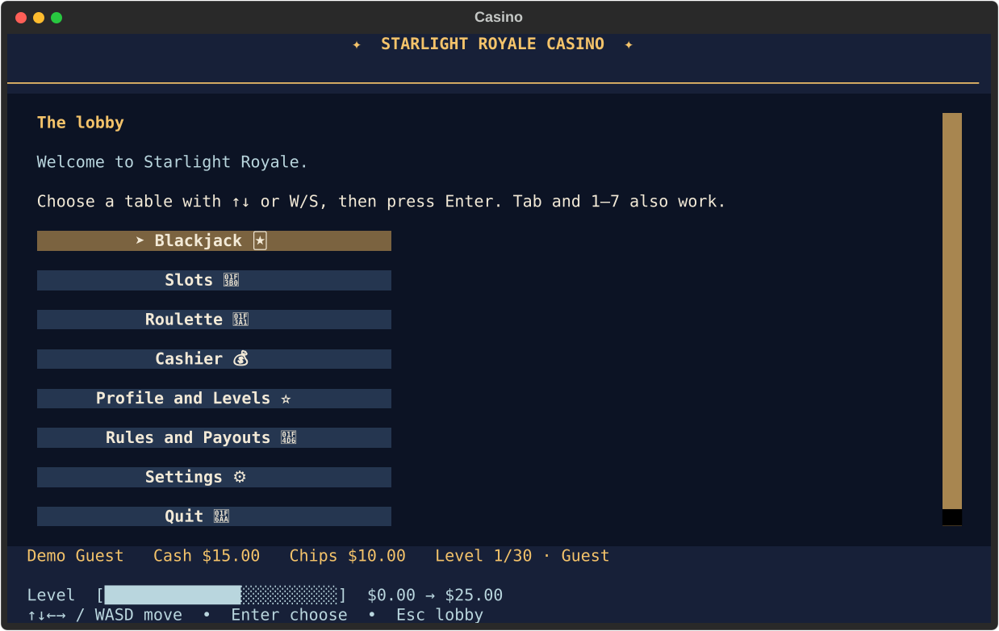
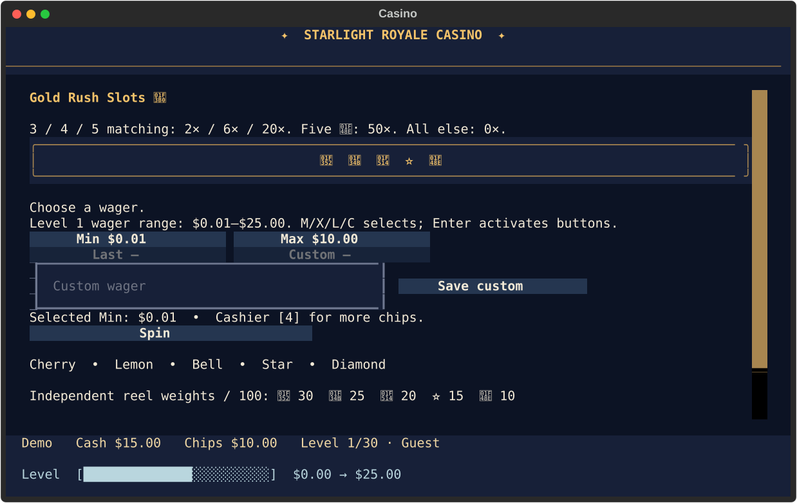
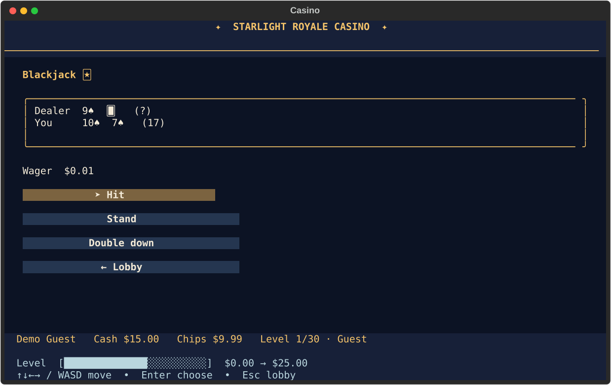

# Starlight Royale Casino

A terminal casino with three games, a cashier, and a cash-based membership ladder. It uses **virtual cash and virtual chips only**. There are no payments, purchases, prizes, bank connections, or redemption for money.







The default interface uses warm gold on deep blue, with a few starlight and frontier details. Settings offers ten casino color themes. Menus and rules keep text labels beside emoji. Terminal emoji width varies by font; if a symbol looks crowded, its text label and the rules remain readable. A window smaller than 70 columns by 22 rows shows a resize message.

## Install once, then launch

Python 3.10 or newer and Git are required. [pipx](https://pipx.pypa.io/stable/installation/) installs this command in its own environment and puts `starlight` on your normal PATH.

**macOS / Linux (Terminal):**

```sh
git clone https://github.com/SavelMoshi/starlight-royale.git
cd starlight-royale
python3 -m pip install --user pipx
python3 -m pipx ensurepath
python3 -m pipx install .
# Open a new Terminal window, then run:
starlight
```

**Windows CMD:**

```bat
git clone https://github.com/SavelMoshi/starlight-royale.git
cd starlight-royale
py -m pip install --user pipx
py -m pipx ensurepath
py -m pipx install .
REM Open a new CMD window, then run:
starlight
```

If `pipx` is already installed, start with `pipx install .` (or `py -m pipx install .` on Windows). Some managed Python installs require installing pipx through the OS package manager; see the linked pipx instructions. The fallback entry point is `python -m starlight_royale` in any Python environment where this project is installed. A local virtual environment also works:

```sh
python3 -m venv .venv
source .venv/bin/activate
python -m pip install .
starlight
```

For Windows CMD, replace the first two virtual-environment lines with `py -m venv .venv` and `.venv\Scripts\activate.bat`. PowerShell can use the pipx commands above with `py -m`, too. A virtual environment must be activated in each new shell; pipx is the route to an everyday `starlight` command without activation. Installation and the console script were verified in a fresh virtual environment on macOS. Windows CMD was configured but could not be run locally.

### Update an existing installation

`git pull` updates the source checkout but does **not** update a copy already installed by pipx. To replace an older `starlight` installation and make future pipx upgrades follow this public repository, run:

**macOS / Linux:**

```sh
pipx install --force git+https://github.com/SavelMoshi/starlight-royale.git
pipx list
starlight
```

**Windows CMD:**

```bat
py -m pipx install --force git+https://github.com/SavelMoshi/starlight-royale.git
py -m pipx list
starlight
```

`pipx list` should show `starlight-royale 1.2.0` or newer. The reinstall does not remove local player saves. If you installed into a virtual environment instead, activate it and run `python -m pip install --upgrade .` from an updated checkout.

## Controls and first visit

Use **↑ ↓ ← →** or **W A S D** to move between controls and **Enter** to choose the focused option. The angled arrow **➤** marks keyboard focus; **☞** marks a button under the mouse. Focused or hovered buttons also change color. **Tab** and **Shift+Tab** still work. **Esc** returns to the lobby, **Q** quits when not typing in a text field, and **1–7** jump to lobby destinations. Text fields accept letters normally; **↑/↓** or Tab moves out of a field, while **←/→** edits text. In a dropdown, use **↑/↓** or **W/S** to choose an option and Enter to confirm it. On game screens, **M**, **X**, **L**, and **C** still select the minimum, maximum, last, or saved custom wager. Type a custom amount and press Enter to save it; focus then moves to the game's main action. Blackjack also supports **H** for Hit and **N** to change wager. The slot selector still supports **G**, **M**, and **V** for its three machines.

Create a display name and choose USD (`$`), EUR (`€`), or GBP (`£`) when the app first opens. This changes the display symbol only; it performs no exchange conversion. You start with **25.00 virtual cash and zero chips**. Visit the **Cashier** and deposit cash into chips before playing.

Settings lets you create, switch, edit, and delete up to **five local accounts**. Each has its own balances, game history, saved bets, slot machine, roulette selection, and color theme. Editing can change the display name and currency symbol. Deleting an account requires a confirmation screen and removes its local data. The ten color themes are Night Gold, Sapphire, Emerald, Amethyst, Ruby, Copper, Midnight Teal, Rose Noir, Arctic, and Slate.

The cashier transfers at **1 cash = 1 chip**. Deposit moves cash to chips; withdraw moves chips to cash. **Free top-up** adds cash in an amount you choose. Transfers and top-ups do not affect gameplay profit or loss. Amounts must be positive, affordable where applicable, and have no more than two decimal places. Balances use decimal arithmetic and always display two places.

Each cash level has a wager range. The **minimum** is 0.1% of that level's cash threshold, rounded up to a cent, with a floor of 0.01. The **maximum** is the next level's cash threshold; level 30 allows up to 20,000,000. Available chips may be lower than the level maximum. Blackjack double down must also stay within the level maximum. Moving cash to chips can lower the level and its wager range. The selected wager mode, last actual wager, and custom wager are saved separately for Blackjack, Roulette, and each slot machine.

## Games and payouts

Payout multipliers below are **total chips returned, including the original wager**. A losing bet returns zero. The on-screen rules show the same tables before betting.

### Blackjack 🃏

A shuffled 52-card deck is used for each hand. Number cards are face value, face cards are 10, and aces are 1 or 11. The dealer stands on **all 17s, including soft 17**. Player and dealer naturals are checked before any action.

| Result | Return | Net on a 10.00 wager |
| --- | ---: | ---: |
| Natural blackjack (3:2 profit) | 2.5× | +15.00 |
| Ordinary win or dealer bust | 2× | +10.00 |
| Push | 1× | 0.00 |
| Loss or player bust | 0× | −10.00 |

Hit takes another card. Stand ends your turn and lets the dealer play. Double down is available only on your first two cards if you can match the wager; it draws exactly one card, then stands. No split, insurance, or surrender. A half-cent from a 3:2 payout is rounded **half up** to the nearest cent.

Cards now appear in a short reveal sequence when dealing or hitting. Standing and doubling reveal the dealer's cards one at a time. The animation changes presentation only; the Blackjack rules decide the outcome, and the balance is saved before the reveal finishes.

### Slots 🎰

Choose among three themed machines. Each has **five independent reels**. The weights shown below are out of 100 on each reel. The highest matching symbol count pays; fewer than three matching symbols return **0×**. Five diamonds use the jackpot return. Odds never depend on level or balance.

| Machine | Symbols and weights per reel | 3 match | 4 match | 5 match | 5 💎 |
| --- | --- | ---: | ---: | ---: | ---: |
| Gold Rush | 🍒 Cherry 30, 🍋 Lemon 25, 🔔 Bell 20, ⭐ Star 15, 💎 Diamond 10 | 2× | 6× | 20× | 50× |
| Moonlight Saloon | 🌵 Cactus 35, 🐎 Horse 25, 🌙 Moon 18, ⭐ Star 14, 💎 Diamond 8 | 2× | 7× | 25× | 60× |
| Royal Vault | 🪙 Coin 35, 🔑 Key 28, 💍 Ring 19, 👑 Crown 12, 💎 Diamond 6 | 2× | 8× | 30× | 80× |

The brief reel animation is separate from the selected outcome and cannot alter the payout. The machine, wager choice, and saved custom wager remain selected for the next spin.

### Roulette 🎡

The European wheel has **0–36**, with one green zero. Place one wager per spin.

| Bet | Win condition | Return |
| --- | --- | ---: |
| Red or black | Result has that color | 2× (1:1 profit) |
| Odd or even | Nonzero result has that parity | 2× (1:1 profit) |
| First, second, or third dozen | 1–12, 13–24, or 25–36 | 3× (2:1 profit) |
| Single number | Exact result, including 0 | 36× (35:1 profit) |

Zero loses on red/black, odd/even, and dozen bets. The chosen bet type, single number, and wager remain selected after a spin and when reopening the app.

The wheel shows a brief visual turn before revealing the result. The spin outcome and payout are calculated independently of that display.

## Cash levels

There are exactly 30 membership levels. **Current cash balance** determines the level and wager range. It is not a permanent achievement or a measure of skill. Depositing cash into chips can lower it; withdrawing chips or taking a free top-up can raise it. The bottom bar shows progress from the current threshold to the next. Level 30 shows a full bar.

| Level | Rank | Cash threshold | Level | Rank | Cash threshold |
| ---: | --- | ---: | ---: | --- | ---: |
| 1 | Guest | 0 | 16 | Gold Ace | 17,500 |
| 2 | New Arrival | 25 | 17 | Gold Circle | 25,000 |
| 3 | Club Visitor | 50 | 18 | Gold Reserve | 40,000 |
| 4 | Card Holder | 100 | 19 | Platinum Guest | 60,000 |
| 5 | Table Regular | 200 | 20 | Platinum Player | 90,000 |
| 6 | House Guest | 350 | 21 | Platinum Ace | 140,000 |
| 7 | Bronze Member | 500 | 22 | Platinum Circle | 220,000 |
| 8 | Bronze Seat | 750 | 23 | High Stakes Member | 350,000 |
| 9 | Bronze Ace | 1,000 | 24 | High Stakes Ace | 550,000 |
| 10 | Silver Ace | 1,500 | 25 | Frontier High Roller | 850,000 |
| 11 | Silver Member | 2,500 | 26 | Royale Member | 1,300,000 |
| 12 | Silver Lounge | 4,000 | 27 | Royale Ace | 2,000,000 |
| 13 | Silver Star | 6,000 | 28 | Royale High Roller | 3,500,000 |
| 14 | Gold Member | 8,500 | 29 | Starlight Elite | 6,000,000 |
| 15 | Gold Spur | 12,000 | 30 | Royale Legend | 10,000,000 |

## Local save and privacy

The versioned JSON save stores up to five accounts, the active account, and each account's display name, currency symbol choice, balances, game counts and wins, gameplay net, dealer line setting, wager selections, and color theme. Version 1 and 2 profiles load as a single account and are upgraded on the next save. Saves are written atomically after balance and setting changes. No player save belongs in the repository.

Default save location:

- macOS/Linux: `~/.local/share/starlight-royale/profile.json` (or under `$XDG_DATA_HOME`)
- Windows: `%APPDATA%\starlight-royale\profile.json`

For testing or a separate save, set `STARLIGHT_SAVE` to a file path before launch. If loading fails, the app explains the problem and leaves the file intact. The recovery button archives it beside the save before creating a new account. You can also quit and inspect the JSON yourself. An interrupted Blackjack hand keeps its already debited wager; it counts as a played hand and a loss in gameplay net, while no win is recorded.

## Development

```sh
python -m pip install ".[dev]"
python -m pytest -q
ruff check .
ruff format --check .
```

Game rules are in `src/starlight_royale/`, separate from `app.py`. Tests inject fixed decks, reel draws, and wheel results. Production draws use `secrets.SystemRandom`. The GitHub Actions workflow runs tests and Ruff on macOS, Linux, and Windows for Python 3.12 and 3.14. The action major versions follow the official [checkout](https://github.com/actions/checkout/releases) and [setup-python](https://github.com/actions/setup-python/releases) release pages.

**Known limits:** This version has one Roulette wager per spin and no Blackjack split, insurance, or surrender. Dealer dialogue is a small set of written lines that can be turned off in Settings. Ollama dialogue is not implemented. Future improvements could save an in-progress Blackjack hand and add terminal font presets for different emoji widths.
